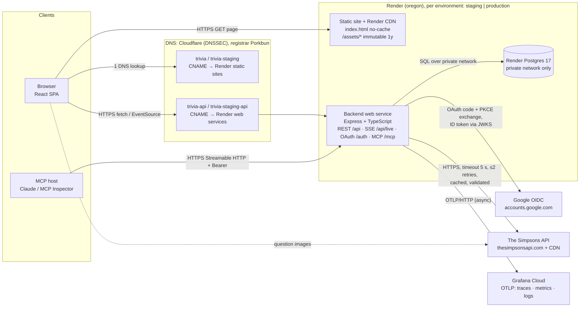
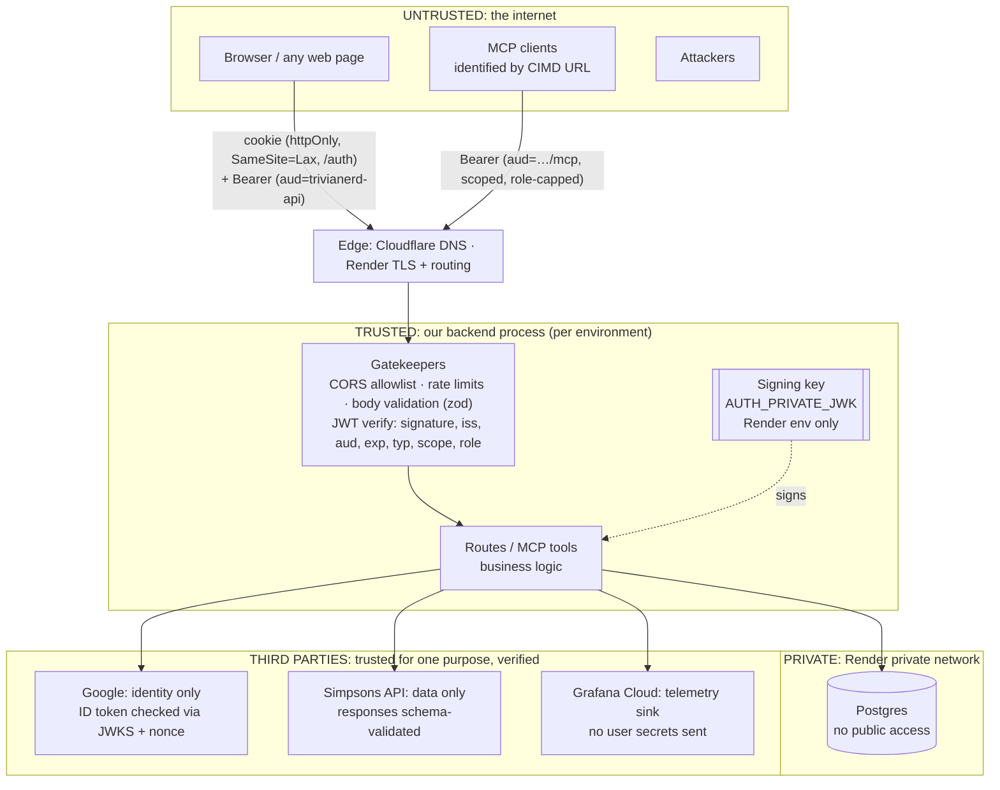
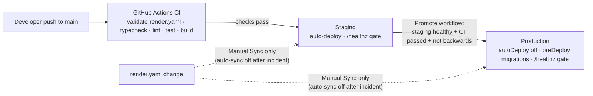

# TriviaNerd architecture (Q2)

Diagrams are Mermaid (rendered by GitHub). Commit at time of writing: see `git log`.

## 1. Request path

Browser → DNS → CDN → app → database / third parties.

**One request, end to end (e.g. `GET /api/questions`):** the browser resolves
`trivia-api.burnscodev.com` through Cloudflare DNS (CNAME to Render), opens TLS to
Render's edge (certificate issued and renewed by Render), and Render routes to the
backend instance. Middleware runs CORS (exact allowlist), security headers, rate limit,
then the route: it reads the question bank from Postgres and, only if the bank is low,
tops it up from The Simpsons API. OpenTelemetry records one trace with child spans for
each Postgres query and each outbound Simpsons API call, exported to Grafana Cloud.

## 2. Trust boundaries

| Boundary | What crosses it | Control |
| --- | --- | --- |
| Internet → backend | HTTP requests from anyone | TLS only (HSTS); CORS exact-origin allowlist (`*` only on public machine endpoints, never with credentials); rate limits per class; zod validation; one JSON error shape |
| Browser session → API | httpOnly session cookie (`/auth` only) → 15-min access token | Cookie never readable by JS; token endpoint requires our Origin (CSRF); access token kept in memory only |
| MCP client → `/mcp` | Bearer token | Audience must be the MCP URL (web tokens refused, and vice versa); per-tool scopes (403 `insufficient_scope`); role re-checked per call; writes need a server-enforced confirmation code; every call audited |
| MCP client registration | Client ID Metadata Document URL | SSRF-guarded fetch (https only, non-public addresses refused after DNS, no redirects, timeout, size cap); exact `client_id` match; exact redirect-URI match; consent screen shows redirect host |
| Backend → Postgres | SQL | Private network only (`ipAllowList: []`); parameterised queries (Drizzle) |
| Backend → Google | Code + PKCE verifier + client secret | Secret only in Render env; ID token verified (JWKS, iss, aud, exp, nonce) |
| Backend → Simpsons API | Public GETs | Timeout, bounded retry, cache, single-flight + cooldown, schema validation, graceful degradation |
| Backend → Grafana | Telemetry | Token only in Render env; no tokens/cookies logged (pino redaction) |
| MCP App iframe → host | `tools/call` via postMessage | No network of its own (CSP `connect-src 'none'`); host forwards over the user's authenticated connection; server checks scope + session ownership |

## 3. Environments and delivery

