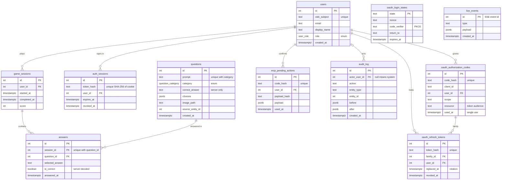

# F4: persistent PostgreSQL storage (schema, keys, indexes, restart test)

Production and staging use **Render Postgres 17**. Local development and tests use
PGlite (PostgreSQL compiled to WebAssembly) with the **same SQL migrations**. The
schema lives in `backend/src/db/schema.ts`. Migrations `0000`–`0005` are in
`backend/src/db/migrations`, with down-migrations for `0001`–`0005` in
`backend/src/db/migrations-down` (F5).

## ER diagram



Relationship notes: `audit_log.actor_user_id` is nullable (null = system or CLI);
`oauth_refresh_tokens.family_id` groups all tokens from one authorization code;
`oauth_login_states` stands alone (keyed by the random `state`, no foreign keys).

## What the database enforces

* **Primary keys:** every one of the 11 tables. Identity columns everywhere except
  `oauth_login_states`, which is keyed by its random `state`.
* **9 foreign keys, all `ON DELETE NO ACTION`:** a referenced row cannot be deleted
  while anything points at it. This is why `DELETE /api/questions/:id` returns
  **409** for a question that players have answered: the answer history is never
  orphaned or silently lost.
* **Enums:** `user_role` (viewer, operator) and `question_category`. An invalid role
  cannot be stored even by a buggy code path.
* **14 indexes** (7 unique), each tied to a query or rule:

| Index | Columns | Serves |
| --- | --- | --- |
| `users_oidc_subject_idx` (unique) | `oidc_subject` | login lookup; no duplicate accounts |
| `questions_category_idx` | `category` | category filter |
| `questions_category_prompt_uq` (unique) | `category, prompt` | bank top-up uses `ON CONFLICT DO NOTHING`; duplicate create → 409 |
| `game_sessions_user_id_idx` | `user_id` | "my sessions", leaderboard grouping |
| `answers_session_id_idx` | `session_id` | scoring reads all answers of a session |
| `answers_session_question_uq` (unique) | `session_id, question_id` | one answer per question per session → 409 on repeats, even under concurrent requests |
| `auth_sessions_token_hash_idx` (unique) | `token_hash` | every `/auth/token` refresh |
| `auth_sessions_user_id_idx` | `user_id` | revoke a user's sessions |
| `oauth_codes_hash_uq` (unique) | `code_hash` | MCP token endpoint |
| `oauth_refresh_hash_uq` (unique) | `token_hash` | MCP refresh |
| `oauth_refresh_family_idx` | `family_id` | revoke a whole token family on reuse |
| `mcp_pending_code_uq` (unique) | `code_hash` | `add_question` confirmation lookup |
| `live_events_created_at_idx` | `created_at` | pruning old live events |
| `audit_log_entity_idx` | `entity_type, entity_id` | "history of this entity" queries |

## Restart test 1: local, compiled server, file-backed database

Run 2026-11-23 ~05:09–05:10 UTC against `node dist/server.js` with a PGlite database
on disk, synthetic users and a throwaway signing key. Data was written through the
API, the server process was **stopped**, and a **new process** was started on the
same database:

```
before stop (process 1):
  viewer: POST /api/sessions -> 201 {"id":1,"userId":1,...,"score":0}
  viewer: POST /api/sessions/1/answers (q1, Right) -> 201 ... "isCorrect":true
  viewer: POST /api/sessions/1/answers (q2, W1)    -> 201 ... "isCorrect":false
  operator: POST /api/questions -> 201 {"id":73,"prompt":"Who owns the Leftorium?",...}
  operator: DELETE /api/questions/73 -> 204

after restart (process 2):
  healthz: status=ok database=ok startedAt=2026-11-23T05:10:11.149Z
  GET /api/sessions/1 -> 200 {"session":{"id":1,...,"score":10},"score":{"correctCount":1,"totalCount":2,"percentage":50,"points":10}}
  GET /api/questions/1 -> 200 {"id":1,"prompt":"Evidence question 0?",...}
  GET /api/questions/73 (deleted before restart) -> 404 {"error":{"code":"NOT_FOUND",...}}
  GET /api/leaderboard -> 200 {"leaderboard":[{"rank":1,"player":"Sleepy Comet #1","points":10,"sessions":1}],"lastEventId":2}
```

Writes and deletes both survived the restart exactly.

## Restart test 2: staging, Render Postgres

Public data was read from outside. The student then restarted the service in Render
(Manual Deploy → Restart service), and the same reads were repeated. The new
instance's `startedAt` proves a new process; the data comes back unchanged from
Render Postgres:

```
## BEFORE restart (2026-11-23T05:10:38Z)
healthz: {"status":"ok","checks":{"database":"ok"},"commit":"0dfba4c36366cee249e9422a5fed756aa955b5e3","startedAt":"2026-11-23T04:49:34.080Z",...}
leaderboard: {"leaderboard":[{"rank":1,"player":"Sleepy Comet #1","points":80,"sessions":4}],"lastEventId":11}
question 38: {"id":38,"prompt":"What is Roger Meyers Jr.'s occupation?","category":"character",...}
question 39: {"id":39,"prompt":"What is Sanjay Nahasapeemapetilon's occupation?","category":"character",...}
question 90: {"id":90,"prompt":"What is Tina Ballerina's occupation?","category":"character",...}

## AFTER restart (2026-11-23T05:16:44Z)
healthz: {"status":"ok","checks":{"database":"ok"},"commit":"0dfba4c36366cee249e9422a5fed756aa955b5e3","startedAt":"2026-11-23T05:16:37.281Z",...}
leaderboard: {"leaderboard":[{"rank":1,"player":"Sleepy Comet #1","points":80,"sessions":4}],"lastEventId":11}
question 38: {"id":38,"prompt":"What is Roger Meyers Jr.'s occupation?","category":"character",...}
question 39: {"id":39,"prompt":"What is Sanjay Nahasapeemapetilon's occupation?","category":"character",...}
question 90: {"id":90,"prompt":"What is Tina Ballerina's occupation?","category":"character",...}
```

The process changed (`startedAt` 04:49:34 → 05:16:37, same commit `0dfba4c`). The
leaderboard (80 points over 4 sessions, last live event 11) and questions 38, 39 and
90 are identical. Nothing the app needs lives in process memory. The live-event id
continuing from 11 also shows that the SSE replay position survives restarts (F11).
